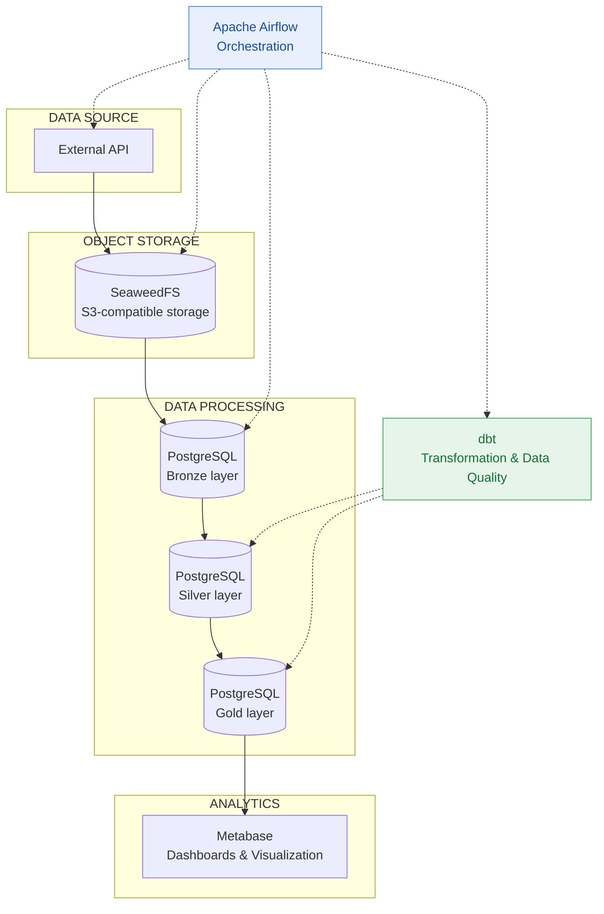
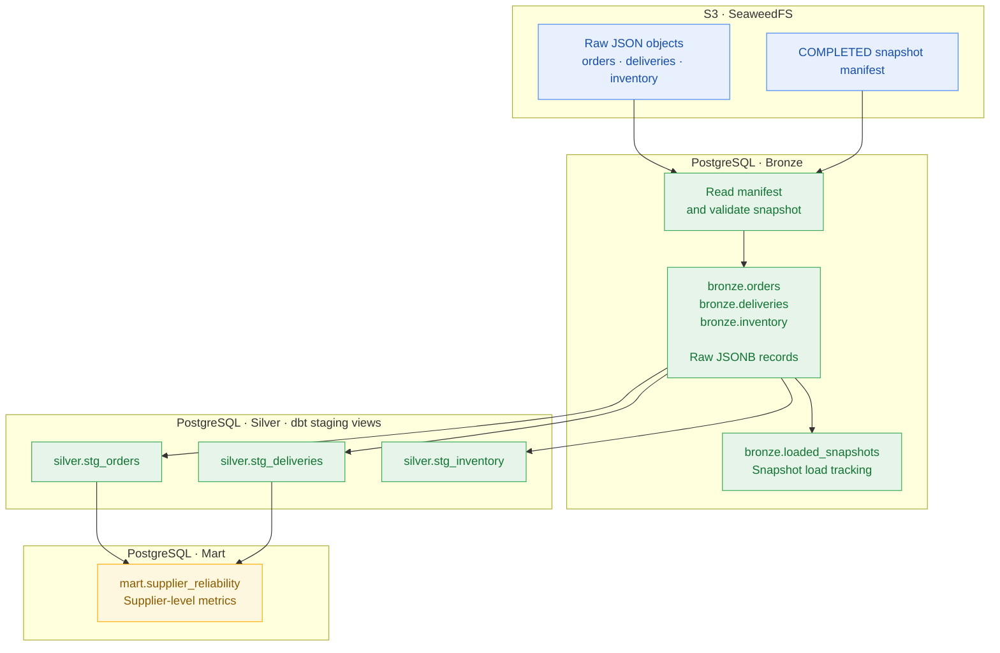
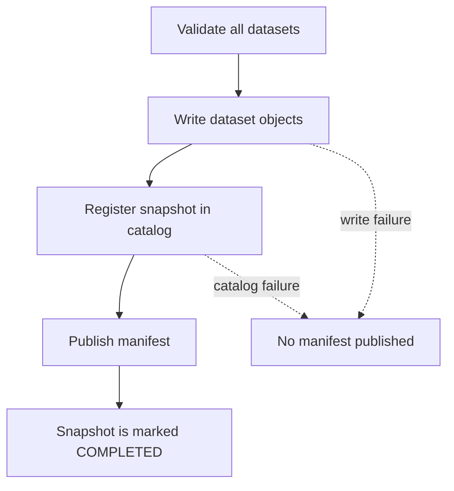
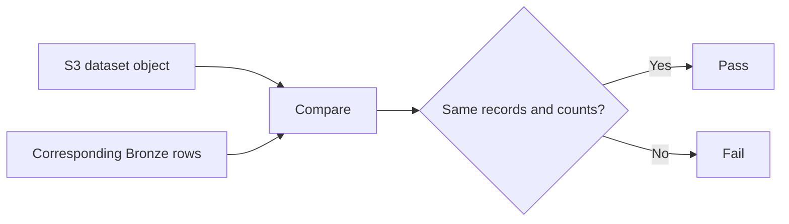

# ELTpipeline-commerce

**Data Engineering Project**

## Overview

ELTpipeline-commerce is a standalone ELT pipeline designed to ingest data from an external API, store and transform it across multiple data layers, and prepare it for analytical visualization.

The project focuses on reliable data delivery, data integrity, and consistency across pipeline stages.

### Key Features

- API data ingestion and object storage.
- Multi-layer data processing (Bronze → Silver → Gold).
- Workflow orchestration with Apache Airflow.
- Data transformation and quality validation using dbt.
- Centralized logging and pipeline monitoring.
- Analytical data visualization with Metabase.

### Technology Stack

Python · Apache Airflow · PostgreSQL · dbt · Docker · SeaweedFS (S3) · Metabase · GitHub Actions

## Architecture

The pipeline follows a multi-layer ELT architecture. Data is ingested from an external API, stored in S3-compatible object storage, loaded into PostgreSQL, transformed through successive data layers, and prepared for analytical consumption.

### High-Level Architecture



**Legend:**
- Solid arrows — data flow.
- Dashed arrows — orchestration and transformation responsibilities.

## Data Ingestion

### 1. Ingestion Overview

The ingestion layer retrieves three datasets from the source API:

- **Orders** — order records, requested through `GET /orders`.
- **Deliveries** — delivery records, requested through `GET /delivery`.
- **Inventory** — inventory records, requested through `GET /inventory`.

These datasets are collected as part of a single ingestion run and grouped into one logical snapshot.

The extraction process uses two concurrent execution branches:

- Orders and deliveries are fetched sequentially.
- Inventory is fetched independently and concurrently with the orders/deliveries branch.

Before storage, each API response is validated for its expected structure and record count. Once all datasets have been successfully retrieved and validated, the ingestion process proceeds with snapshot creation and S3 storage.

### 2. Ingestion Workflow

The workflow below shows the extraction and publication stages. The two API branches run concurrently; requests within the orders/deliveries branch remain sequential.


The API client retries transient HTTP and connection failures. The extraction layer then checks that each response is a JSON array containing the expected number of JSON objects. The default request limit for orders and deliveries is 100 records; the unfiltered inventory endpoint is expected to return 500 records.

A response that fails these completeness checks is rejected before the snapshot is written to S3. These checks validate the expected response shape and size; they do not independently prove that the source API has not omitted records.

### 3. Snapshot Identification

Each ingestion run is assigned a unique `snapshot_id`, generated using UUID4 after all three datasets have been fetched successfully.

The same identifier is used to associate all three dataset objects with their corresponding manifest.

The storage layer uses three key concepts:

| Identifier | Purpose |
|---|---|
| `snapshot_id` | Identifies the complete ingestion snapshot |
| `object_key` | Identifies an individual dataset object in S3 |
| `manifest_key` | Identifies the snapshot manifest |

The current implementation does not generate separate request IDs for the three HTTP calls. Instead, the three datasets are grouped under one snapshot identifier.

### 4. S3 Object Structure

Each dataset is stored as a separate immutable JSON object. Its key includes the dataset name, the UTC date, and the shared snapshot ID.

Example object layout:

```text
elt-raw/
├── orders/
│   └── 2026-11-02/
│       └── 7f3a9c2e6b1d4a8f9e0c5b7d2a6f1c43.json
├── deliveries/
│   └── 2026-11-02/
│       └── 7f3a9c2e6b1d4a8f9e0c5b7d2a6f1c43.json
├── inventory/
│   └── 2026-11-02/
│       └── 7f3a9c2e6b1d4a8f9e0c5b7d2a6f1c43.json
└── snapshots/
    ├── catalog.json
    └── 7f3a9c2e6b1d4a8f9e0c5b7d2a6f1c43/
        └── manifest.json
```

The example uses a shortened illustrative snapshot layout; the snapshot ID shown is an example UUID4 value.

### 5. Snapshot Manifest

Each successfully published snapshot has a manifest stored at:

`snapshots/<snapshot_id>/manifest.json`

The manifest describes the snapshot, its completion status, and the location and record count of each dataset.

Example manifest:

```json
{
  "format_version": 1,
  "snapshot_id": "7f3a9c2e6b1d4a8f9e0c5b7d2a6f1c43",
  "status": "COMPLETED",
  "created_at": "2026-11-02T12:00:00+00:00",
  "datasets": {
    "orders": {
      "object_key": "orders/2026-11-02/7f3a9c2e6b1d4a8f9e0c5b7d2a6f1c43.json",
      "record_count": 100
    },
    "deliveries": {
      "object_key": "deliveries/2026-11-02/7f3a9c2e6b1d4a8f9e0c5b7d2a6f1c43.json",
      "record_count": 100
    },
    "inventory": {
      "object_key": "inventory/2026-11-02/7f3a9c2e6b1d4a8f9e0c5b7d2a6f1c43.json",
      "record_count": 500
    }
  }
}
```

The `manifest_key` is derived from the snapshot ID and is used by downstream stages to locate the manifest. It is not duplicated as a field inside the manifest itself.

### 6. Completion and Consistency

The publication sequence is:

1. Validate that all three required datasets are present and contain JSON object records.
2. Write each dataset as an immutable S3 object.
3. Register the snapshot and its manifest key in `snapshots/catalog.json`.
4. Write the manifest as the final publication step.

The manifest is the authoritative completion marker. A catalog entry alone does not indicate that a snapshot is complete: if publication fails after catalog registration but before manifest creation, the catalog may temporarily contain an entry whose manifest does not yet exist. The restore process safely skips such entries.

The extraction task returns the `snapshot_id` to Airflow. The following Bronze-loading task receives that exact ID and reads the corresponding manifest and dataset objects from S3. This separates API extraction from Bronze loading and allows the Bronze task to retry without fetching the source API again.

### 7. Failure Handling

| Situation | Ingestion behavior |
|---|---|
| Temporary API HTTP or connection failure | The API client retries the request, up to its configured retry limit. |
| API response has an unexpected structure or record count | Extraction fails validation; the incomplete package is not published to S3. |
| Temporary S3 publication failure | The publication operation is retried up to three attempts using the same snapshot ID and timestamp. |
| Non-retryable S3 error or exhausted retries | The extraction task fails; a completion manifest is not published. |
| Failure after catalog registration but before manifest creation | The catalog may contain a stale reference; restore skips the entry if its manifest is absent. |
| Bronze loading fails after successful extraction | Airflow can retry Bronze loading using the same snapshot ID, without repeating API extraction. |

This design keeps the API extraction result separate from downstream database loading and prevents an incomplete S3 publication from being treated as a completed snapshot.

## Data Transformation: S3 → Bronze → Staging → Mart

The transformation layer converts a completed S3 snapshot into structured PostgreSQL data and then prepares it for analytical use.

### End-to-End Data Flow



### Layer Responsibilities

| Layer | Purpose | Implementation |
|---|---|---|
| **S3** | Stores the raw dataset objects and the manifest identifying a completed snapshot. | SeaweedFS (S3-compatible object storage) |
| **Bronze** | Loads the snapshot records into PostgreSQL while retaining each original JSON record as `JSONB`. | `bronze.orders`, `bronze.deliveries`, `bronze.inventory` |
| **Staging (Silver)** | Extracts typed columns from raw JSON, filters invalid records, and deduplicates records using ingestion metadata. | dbt views: `silver.stg_orders`, `silver.stg_deliveries`, `silver.stg_inventory` |
| **Mart** | Combines order and delivery data into supplier-level analytical metrics. | dbt table: `mart.supplier_reliability` |

### S3 → Bronze

The Bronze loader receives the `snapshot_id` produced by the extraction task. It reads the corresponding manifest and the three dataset objects from S3; it does not call the source API.

Before inserting records, the loader validates the manifest status and identity, required datasets, object keys, JSON record types, and record counts. The snapshot is then loaded into the corresponding Bronze tables in a PostgreSQL transaction.

Each raw record is stored in `raw_payload` as JSONB, together with its `source_object_key` and a per-object `record_index`. The `bronze.loaded_snapshots` table tracks successfully loaded snapshots. A unique constraint on the snapshot ID and unique indexes on source object key plus record index support safe retries and prevent duplicate insertion.

If the snapshot has already been loaded with the same manifest, the loader treats the operation as already completed. If loading fails, the transaction is rolled back.

### Bronze → Staging (Silver)

dbt staging models read the raw records from Bronze and expose typed relational columns as PostgreSQL views.

The models:
- Extract fields from the JSONB payload and cast them to appropriate data types.
- Filter records that do not meet the model's basic validity conditions.
- Deduplicate records using business identifiers and ingestion metadata, preferring the latest record.
- Keep orders, deliveries, and inventory as separate staging models.

These models provide a structured input for downstream transformations without replacing the raw Bronze data.

### Staging → Mart

The `mart.supplier_reliability` model is materialized as a table. It aggregates order metrics by supplier, calculates delivery metrics from orders joined with deliveries, and combines the results.

The resulting dataset includes total orders, delivered orders, planned and delivered quantities, fulfillment rate, and average delivery delay in days. Inventory is prepared in staging but is not currently used by this mart model.

dbt tests validate model constraints and relationships, while additional SQL tests check business rules and consistency.


## Data Tests

Data quality is validated at multiple boundaries of the pipeline. Python unit tests verify ingestion and snapshot contracts, an integration test checks the S3-to-Bronze boundary against the running services, and dbt tests validate the structured staging models and analytical Mart.

The examples below are illustrative test inputs and outcomes. They explain the assertions; they are not claims about the current production dataset.

### 1. API Response Contract

**Test file:** [`tests/unit/test_fetch_contract.py`](https://github.com/EduardOrEdward/ELTpipeline-commerce/blob/main/tests/unit/test_fetch_contract.py)

These tests verify that the source API returns data in the expected shape before the ingestion process creates a snapshot:

- The response must be a JSON array.
- Every array element must be a JSON object.
- Orders and deliveries must contain the requested number of records.
- The unfiltered inventory response must contain the expected 500 records.

For example, if the ingestion request asks for three orders but receives only two, the response is rejected:

```text
Expected orders: 3
Received orders: 2

Result: ValueError — incomplete API response
```

The checks validate the expected response structure and size. They cannot independently prove that the source API itself has not omitted records.

### 2. Snapshot Publication and S3 Integrity

**Test file:** [`tests/unit/test_snapshot_storage.py`](https://github.com/EduardOrEdward/ELTpipeline-commerce/blob/main/tests/unit/test_snapshot_storage.py)

These tests validate the publication contract implemented by the storage layer:

- All required datasets must be present; unexpected datasets are rejected.
- Each dataset must be a JSON array containing only JSON objects.
- An empty or incomplete snapshot is rejected before any write.
- Dataset objects are written before the catalog entry, and the manifest is published last.
- A failed dataset or catalog write must not publish a completion manifest.
- An S3 conditional-write conflict is accepted only when the existing object has identical content.

The publication order is important because the manifest is the authoritative completion marker:



For example, if the `deliveries` object cannot be written, the test expects the storage operation to fail without registering the snapshot or publishing its manifest. A catalog entry by itself is therefore not treated as proof of completion.

### 3. Bronze Snapshot Contract

**Test file:** [`tests/unit/test_bronze_snapshot_contract.py`](https://github.com/EduardOrEdward/ELTpipeline-commerce/blob/main/tests/unit/test_bronze_snapshot_contract.py)

Before data is inserted into PostgreSQL, the Bronze loader validates the completed snapshot against its manifest. The tests cover:

- Acceptance of a complete snapshot.
- Supported manifest format version.
- Presence of all required datasets.
- Agreement between the requested snapshot ID and the object-key paths.
- Valid, non-negative integer record counts (a boolean is not accepted as an integer count).
- JSON object records in each dataset.
- Exact correspondence between the objects supplied for loading and the objects listed in the manifest.

The following example illustrates a snapshot identity mismatch:

```text
Requested snapshot: snapshot-001
Manifest snapshot:  snapshot-001
Orders object key:  orders/2026-10-15/another-snapshot.json

Result: rejected — object does not belong to snapshot-001
```

This prevents a manifest from accidentally or incorrectly combining objects from different snapshots.

### 4. Separation of Ingestion Stages

**Test file:** [`tests/unit/test_ingestion_stages.py`](https://github.com/EduardOrEdward/ELTpipeline-commerce/blob/main/tests/unit/test_ingestion_stages.py)

These tests protect the boundary between API extraction and Bronze loading:

- API extraction publishes a snapshot to S3 without requiring a PostgreSQL connection.
- A transient S3 publication failure retries with the same `snapshot_id` and timestamp, without fetching the API data again.
- Bronze loading reads an existing snapshot from S3 and does not call the source API.

For example, when the first S3 publication attempt fails temporarily, the test verifies that the second attempt reuses the original snapshot identity and the already-fetched datasets. This avoids turning a storage retry into a new source extraction.

### 5. S3–Bronze Integration Verification

**Test file:** [`tests/integration/verify_pipeline.py`](https://github.com/EduardOrEdward/ELTpipeline-commerce/blob/main/tests/integration/verify_pipeline.py)

Unlike the unit tests, this script checks the S3 and PostgreSQL boundaries against the running integration environment.

The verification covers:

- Successful, non-empty JSON responses from the API endpoints.
- Snapshot catalog and manifest structure, status, identity, and dataset coverage.
- Correspondence between completed S3 objects and the records loaded into Bronze.
- Equality of the canonicalized source records and Bronze JSON payloads.
- Rejection of attempts to overwrite an existing immutable S3 object.
- Idempotent replay: loading an already loaded snapshot must be a no-op.
- Restricted ingestion credentials: the integration check verifies that they cannot perform bucket-wide listing.

The central data comparison can be represented as follows:



For example, if an S3 object contains 100 records, the corresponding Bronze rows must represent those same 100 records. Matching counts alone are insufficient: the integration check also compares the record contents.

The integration workflow additionally replays a loaded snapshot and verifies that no new Bronze rows are inserted. It also attempts a conditional write against an existing object and checks that the original content remains unchanged.

### 6. dbt Tests: Staging and Mart

dbt tests validate the relational models after raw JSON records have been exposed as typed staging views and aggregated into the Mart.

#### Generic tests

**Files:** [`dbt/models/staging/schema.yml`](https://github.com/EduardOrEdward/ELTpipeline-commerce/blob/main/dbt/models/staging/schema.yml) and [`dbt/models/mart/schema.yml`](https://github.com/EduardOrEdward/ELTpipeline-commerce/blob/main/dbt/models/mart/schema.yml)

The schema-level tests check column constraints and relationships, including:

- `not_null` for required identifiers and business fields.
- `unique` for identifiers and model grains that must not contain duplicates.
- `relationships` to ensure that each staged delivery references an existing staged order.

For example, a delivery with `order_id = 501` fails the relationship test if no row with `order_id = 501` exists in `stg_orders`.

#### Singular SQL tests

**Directory:** [`dbt/tests/`](https://github.com/EduardOrEdward/ELTpipeline-commerce/tree/main/dbt/tests)

These SQL queries return rows that violate a specific business rule. A test passes when its query returns no rows.

| Test | Validation |
|---|---|
| `assert_inventory_unique_product_snapshot` | One staging row per product and inventory snapshot date. |
| `assert_order_date_sequence` | Expected delivery date must not precede the order date. |
| `assert_silver_quantities_valid` | Staged order, delivery, and inventory quantities must satisfy their validity rules. |
| `assert_supplier_reliability_contract` | Mart output must satisfy its metric and value constraints. |
| `assert_supplier_reliability_reconciles_to_silver` | Mart aggregates must match independently recalculated aggregates from Silver. |

The reconciliation test is particularly important: it recalculates supplier-level metrics from the staging inputs and compares them with the published Mart rows. It detects discrepancies in the final output, rather than checking only whether individual columns are populated.

#### dbt unit test

**Test:** `supplier_reliability_known_supplier_metrics` in [`dbt/models/mart/schema.yml`](https://github.com/EduardOrEdward/ELTpipeline-commerce/blob/main/dbt/models/mart/schema.yml)

This test supplies controlled input rows to the Mart model and checks the exact expected supplier-level results. It covers aggregation across multiple orders, early delivery, and fulfillment above 1.

Example expected output:

| Supplier | Orders | Planned quantity | Delivered quantity | Fulfillment rate | Average delay |
|---|---:|---:|---:|---:|---:|
| 10 | 2 | 30 | 27 | 0.9000 | -0.50 days |
| 20 | 1 | 5 | 6 | 1.2000 | 4.00 days |

The first supplier has an early delivery, so its average delay is negative. The second supplier received more than the planned quantity, so a fulfillment rate above 1 is valid.

### Test Execution in CI

The GitHub Actions workflow runs the data checks at their corresponding levels:

- Python unit tests are executed with `python -m unittest discover -s tests/unit -v`.
- The integration job runs `tests/integration/verify_pipeline.py` against the running API, S3-compatible storage, and PostgreSQL services. It runs the verification again after restoring Bronze from completed S3 snapshots.
- `dbt build` builds the dbt models and executes their associated tests.

This combination checks individual contracts, cross-service consistency, and the correctness of the analytical models.

