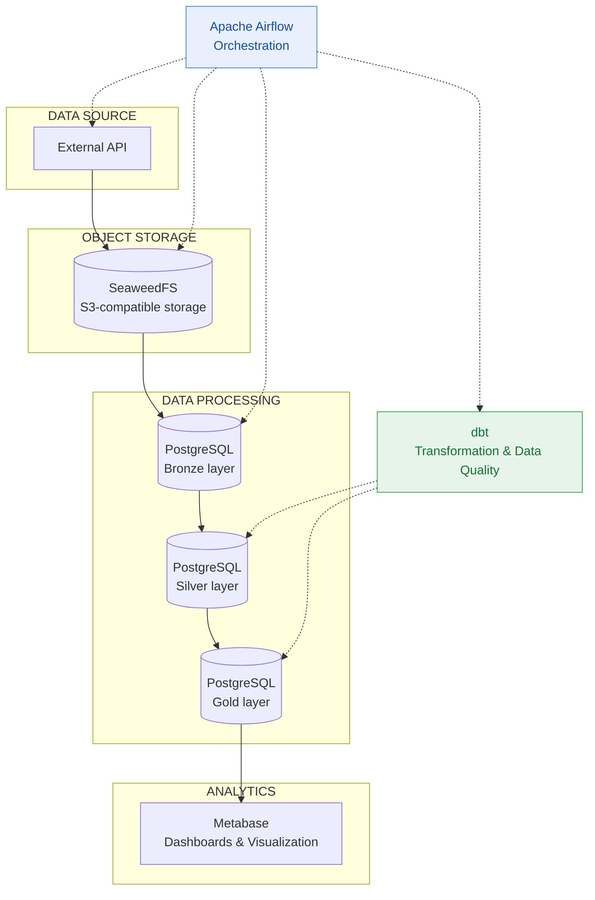
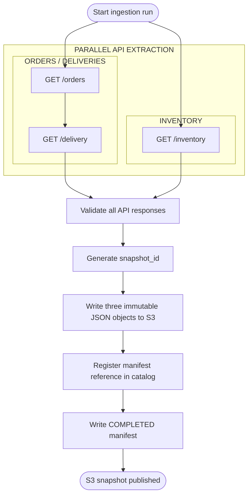
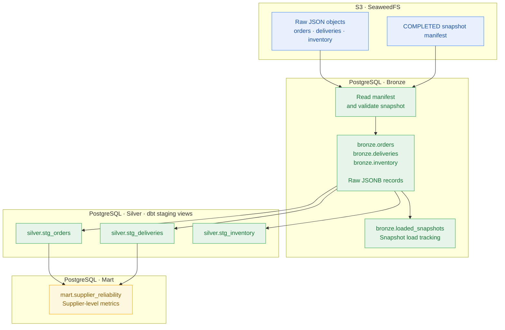

# ELTpipeline-commerce

**Data Engineering Project**

## Overview

ELTpipeline-commerce is a standalone ELT pipeline designed to ingest data from an external API, store and transform it across multiple data layers, and prepare it for analytical visualization.

The project focuses on reliable data delivery, data integrity, and consistency across pipeline stages.

### Key Features

- API data ingestion and object storage.
- Multi-layer data processing (Bronze → Silver → Gold).
- Workflow orchestration with Apache Airflow.
- Data transformation and quality validation using dbt.
- Centralized logging and pipeline monitoring.
- Analytical data visualization with Metabase.

### Technology Stack

Python · Apache Airflow · PostgreSQL · dbt · Docker · SeaweedFS (S3) · Metabase · GitHub Actions

## Architecture

The pipeline follows a multi-layer ELT architecture. Data is ingested from an external API, stored in S3-compatible object storage, loaded into PostgreSQL, transformed through successive data layers, and prepared for analytical consumption.

### High-Level Architecture



**Legend:**
- Solid arrows — data flow.
- Dashed arrows — orchestration and transformation responsibilities.

## Data Ingestion

### 1. Ingestion Overview

The ingestion layer retrieves three datasets from the source API:

- **Orders** — order records, requested through `GET /orders`.
- **Deliveries** — delivery records, requested through `GET /delivery`.
- **Inventory** — inventory records, requested through `GET /inventory`.

These datasets are collected as part of a single ingestion run and grouped into one logical snapshot.

The extraction process uses two concurrent execution branches:

- Orders and deliveries are fetched sequentially.
- Inventory is fetched independently and concurrently with the orders/deliveries branch.

Before storage, each API response is validated for its expected structure and record count. Once all datasets have been successfully retrieved and validated, the ingestion process proceeds with snapshot creation and S3 storage.

### 2. Ingestion Workflow

The workflow below shows the extraction and publication stages. The two API branches run concurrently; requests within the orders/deliveries branch remain sequential.



The API client retries transient HTTP and connection failures. The extraction layer then checks that each response is a JSON array containing the expected number of JSON objects. The default request limit for orders and deliveries is 100 records; the unfiltered inventory endpoint is expected to return 500 records.

A response that fails these completeness checks is rejected before the snapshot is written to S3. These checks validate the expected response shape and size; they do not independently prove that the source API has not omitted records.

### 3. Snapshot Identification

Each ingestion run is assigned a unique `snapshot_id`, generated using UUID4 after all three datasets have been fetched successfully.

The same identifier is used to associate all three dataset objects with their corresponding manifest.

The storage layer uses three key concepts:

| Identifier | Purpose |
|---|---|
| `snapshot_id` | Identifies the complete ingestion snapshot |
| `object_key` | Identifies an individual dataset object in S3 |
| `manifest_key` | Identifies the snapshot manifest |

The current implementation does not generate separate request IDs for the three HTTP calls. Instead, the three datasets are grouped under one snapshot identifier.

### 4. S3 Object Structure

Each dataset is stored as a separate immutable JSON object. Its key includes the dataset name, the UTC date, and the shared snapshot ID.

Example object layout:

```text
elt-raw/
├── orders/
│   └── 2026-11-02/
│       └── 7f3a9c2e6b1d4a8f9e0c5b7d2a6f1c43.json
├── deliveries/
│   └── 2026-11-02/
│       └── 7f3a9c2e6b1d4a8f9e0c5b7d2a6f1c43.json
├── inventory/
│   └── 2026-11-02/
│       └── 7f3a9c2e6b1d4a8f9e0c5b7d2a6f1c43.json
└── snapshots/
    ├── catalog.json
    └── 7f3a9c2e6b1d4a8f9e0c5b7d2a6f1c43/
        └── manifest.json
```

The example uses a shortened illustrative snapshot layout; the snapshot ID shown is an example UUID4 value.

### 5. Snapshot Manifest

Each successfully published snapshot has a manifest stored at:

`snapshots/<snapshot_id>/manifest.json`

The manifest describes the snapshot, its completion status, and the location and record count of each dataset.

Example manifest:

```json
{
  "format_version": 1,
  "snapshot_id": "7f3a9c2e6b1d4a8f9e0c5b7d2a6f1c43",
  "status": "COMPLETED",
  "created_at": "2026-11-02T12:00:00+00:00",
  "datasets": {
    "orders": {
      "object_key": "orders/2026-11-02/7f3a9c2e6b1d4a8f9e0c5b7d2a6f1c43.json",
      "record_count": 100
    },
    "deliveries": {
      "object_key": "deliveries/2026-11-02/7f3a9c2e6b1d4a8f9e0c5b7d2a6f1c43.json",
      "record_count": 100
    },
    "inventory": {
      "object_key": "inventory/2026-11-02/7f3a9c2e6b1d4a8f9e0c5b7d2a6f1c43.json",
      "record_count": 500
    }
  }
}
```

The `manifest_key` is derived from the snapshot ID and is used by downstream stages to locate the manifest. It is not duplicated as a field inside the manifest itself.

### 6. Completion and Consistency

The publication sequence is:

1. Validate that all three required datasets are present and contain JSON object records.
2. Write each dataset as an immutable S3 object.
3. Register the snapshot and its manifest key in `snapshots/catalog.json`.
4. Write the manifest as the final publication step.

The manifest is the authoritative completion marker. A catalog entry alone does not indicate that a snapshot is complete: if publication fails after catalog registration but before manifest creation, the catalog may temporarily contain an entry whose manifest does not yet exist. The restore process safely skips such entries.

The extraction task returns the `snapshot_id` to Airflow. The following Bronze-loading task receives that exact ID and reads the corresponding manifest and dataset objects from S3. This separates API extraction from Bronze loading and allows the Bronze task to retry without fetching the source API again.

### 7. Failure Handling

| Situation | Ingestion behavior |
|---|---|
| Temporary API HTTP or connection failure | The API client retries the request, up to its configured retry limit. |
| API response has an unexpected structure or record count | Extraction fails validation; the incomplete package is not published to S3. |
| Temporary S3 publication failure | The publication operation is retried up to three attempts using the same snapshot ID and timestamp. |
| Non-retryable S3 error or exhausted retries | The extraction task fails; a completion manifest is not published. |
| Failure after catalog registration but before manifest creation | The catalog may contain a stale reference; restore skips the entry if its manifest is absent. |
| Bronze loading fails after successful extraction | Airflow can retry Bronze loading using the same snapshot ID, without repeating API extraction. |

This design keeps the API extraction result separate from downstream database loading and prevents an incomplete S3 publication from being treated as a completed snapshot.

## Data Transformation: S3 → Bronze → Staging → Mart

The transformation layer converts a completed S3 snapshot into structured PostgreSQL data and then prepares it for analytical use.

### End-to-End Data Flow



### Layer Responsibilities

| Layer | Purpose | Implementation |
|---|---|---|
| **S3** | Stores the raw dataset objects and the manifest identifying a completed snapshot. | SeaweedFS (S3-compatible object storage) |
| **Bronze** | Loads the snapshot records into PostgreSQL while retaining each original JSON record as `JSONB`. | `bronze.orders`, `bronze.deliveries`, `bronze.inventory` |
| **Staging (Silver)** | Extracts typed columns from raw JSON, filters invalid records, and deduplicates records using ingestion metadata. | dbt views: `silver.stg_orders`, `silver.stg_deliveries`, `silver.stg_inventory` |
| **Mart** | Combines order and delivery data into supplier-level analytical metrics. | dbt table: `mart.supplier_reliability` |

### S3 → Bronze

The Bronze loader receives the `snapshot_id` produced by the extraction task. It reads the corresponding manifest and the three dataset objects from S3; it does not call the source API.

Before inserting records, the loader validates the manifest status and identity, required datasets, object keys, JSON record types, and record counts. The snapshot is then loaded into the corresponding Bronze tables in a PostgreSQL transaction.

Each raw record is stored in `raw_payload` as JSONB, together with its `source_object_key` and a per-object `record_index`. The `bronze.loaded_snapshots` table tracks successfully loaded snapshots. A unique constraint on the snapshot ID and unique indexes on source object key plus record index support safe retries and prevent duplicate insertion.

If the snapshot has already been loaded with the same manifest, the loader treats the operation as already completed. If loading fails, the transaction is rolled back.

### Bronze → Staging (Silver)

dbt staging models read the raw records from Bronze and expose typed relational columns as PostgreSQL views.

The models:
- Extract fields from the JSONB payload and cast them to appropriate data types.
- Filter records that do not meet the model's basic validity conditions.
- Deduplicate records using business identifiers and ingestion metadata, preferring the latest record.
- Keep orders, deliveries, and inventory as separate staging models.

These models provide a structured input for downstream transformations without replacing the raw Bronze data.

### Staging → Mart

The `mart.supplier_reliability` model is materialized as a table. It aggregates order metrics by supplier, calculates delivery metrics from orders joined with deliveries, and combines the results.

The resulting dataset includes total orders, delivered orders, planned and delivered quantities, fulfillment rate, and average delivery delay in days. Inventory is prepared in staging but is not currently used by this mart model.

dbt tests validate model constraints and relationships, while additional SQL tests check business rules and consistency.

